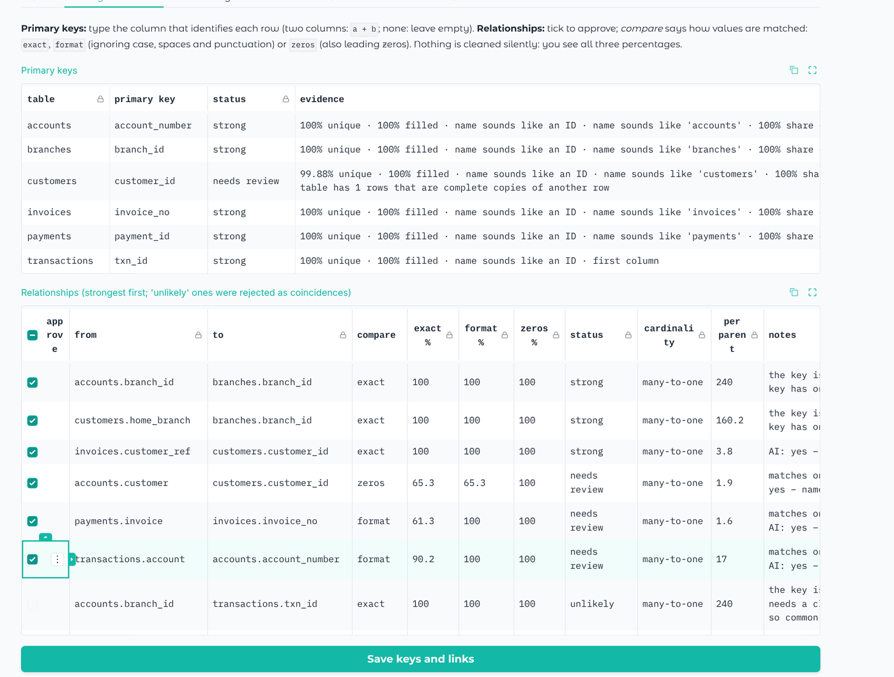
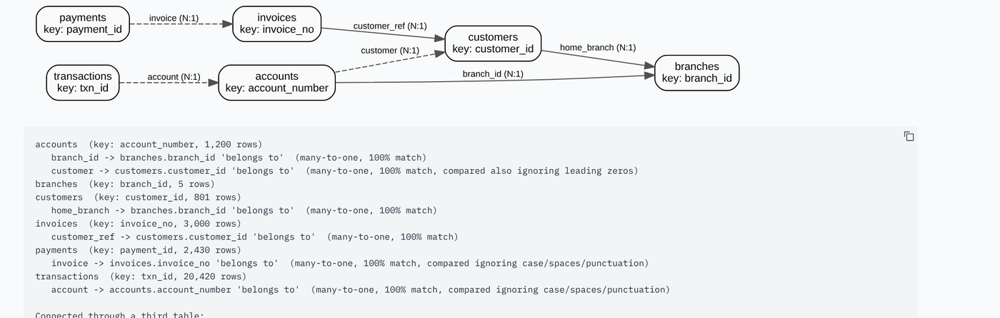
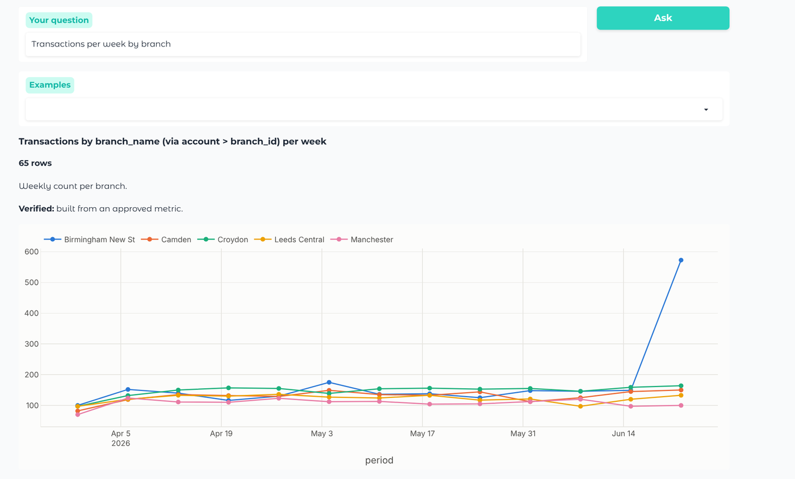
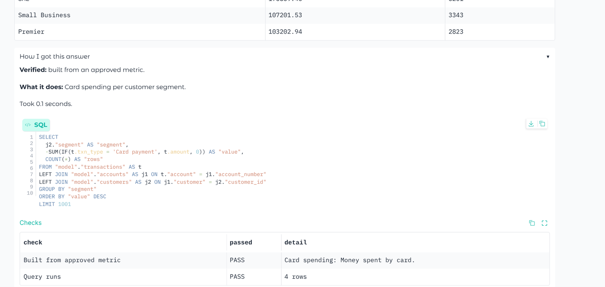
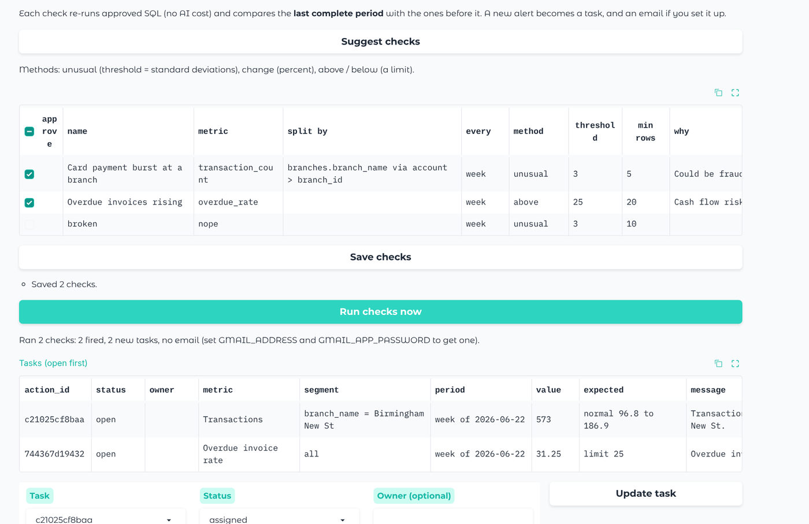

# Tablewise

**Point it at messy tables. It finds the keys and links, cleans the data into views, and turns questions into
checked SQL, charts and alerts — with a person approving every step.**

Most "ask your data" tools let an AI write SQL and hope it's right. Tablewise works the other way round: the code
measures the data, the AI only proposes and comments, and **nothing is used until you approve it**. Every answer
shows its SQL and the checks it passed.



## What it does

| Step | The code does | The AI does | You decide |
|---|---|---|---|
| **1 · Keys and links** | Scores every column as a possible primary key; matches every column against every key in three ways (exact, ignoring case/punctuation, ignoring leading zeros) and measures cardinality | Checks that each link *means* something (`buyer` → `users`), never approves | Tick keys and links, and how values are compared |
| **2 · Meaning and clean views** | Finds types, date formats (day/month order from the values), units (`2 hrs` → 120 mins, `1250p` → £12.50), negatives, personal data | Names each table, explains columns, suggests merges (`DD` → `Direct Debit`) | Types, merges, what happens to personal data |
| **3 · Metrics** | Tests each metric on the data: columns and values exist, it runs, a % stays within 0–100 | Proposes metrics | Which metrics are trusted |
| **4 · Ask** | Builds SQL only from approved metrics and links; free SQL must pass read-only, value, dry-run and privacy checks | Turns the question into a plan, or asks one question back | — |
| **5 · Alerts** | Re-runs approved SQL and compares the last complete period with the 12 before it; new alerts become tasks (never twice) and an email | Proposes what to watch; one sentence per alert | Which checks, which thresholds |

Your raw tables are never changed: the clean data lives in **views** that are always up to date.

## Results on the demo data

The demo is a made-up bank with six messy tables (`examples/finance`): four date formats in one column, amounts
written `£1,250.00`, `12.30 GBP` or `1250p`, IDs that lost their leading zeros or changed case, labels spelled five
ways, a customer exported twice. Two problems are hidden in it.

- **Keys:** all 6 found; the repeated customer is flagged and de-duplicated.
- **Links:** all 6 real links found, including 3 that only match after ignoring format or leading zeros
  (`CUS42` = `CUS00042`); **4 coincidences rejected automatically** (e.g. `payments.installment_no` 1–3 matching the
  branch numbers 1–5).
- **Clean views:** every check passes — every value readable, every key unique, every approved link joins 100%.
- **Alerts:** both hidden problems caught — a burst of transactions at one branch (573 in a week against a normal
  97–187) and the overdue-invoice rate climbing past 25%.



A question becomes a **verified** answer when it's built from an approved metric. Here the tool also noticed that
*branch* can be reached in two ways (the account's branch, or the customer's home branch) and says which one it used:







<sub>Screenshots: the demo data, with the test suite's scripted stand-in for Claude, so they can be reproduced without
an API key. With a real key the AI's wording differs; the numbers come from SQL either way.</sub>

## Run it

Needs Python 3.10 or newer.

```bash
git clone https://github.com/<you>/tablewise.git
cd tablewise
pip install -e .
tablewise demo                      # the finance demo
tablewise app --data path/to/folder # your own CSV / Excel / Parquet files
```

It opens in your browser. Your files are analysed on your own computer with DuckDB; nothing is uploaded anywhere.

**BigQuery:** `pip install -e ".[bigquery]"`, then `gcloud auth application-default login`, then
`tablewise app --bigquery my-project.my_dataset`. The clean views go to a new dataset, `my_dataset_model`.

### The AI is optional — and your key stays private

Steps 1–3 and 5 work without AI (you get fewer suggestions). Asking questions needs Claude. Give it your key in
either way:

- type it into the **Start** tab (kept in memory only, gone when you close the app), or
- set an environment variable before starting: `export ANTHROPIC_API_KEY=sk-ant-...`

The key is **never written to any file**: not to the settings, the cache or the logs. A test
(`tests/test_pipeline.py::test_the_key_is_never_written`) checks this on every run. Answers are cached, so the same
question twice costs nothing, and each session stops at a spending limit (`--budget`, default $0.50).

**What the AI sees:** table and column names, types, the *form* of values (`CUS00042` → `AAA99999`), match
percentages, and the values of category columns (like `Retail`, `SME`). Never IDs, names, contact details or
amounts. Personal columns are removed from the views, replaced by a code that still joins, or reduced to an age.

### Email alerts (optional)

Set `GMAIL_ADDRESS` and `GMAIL_APP_PASSWORD` (a Gmail *app password*) as environment variables.

## How it's built

```
tablewise/
  backends.py   DuckDB (local files) and BigQuery; SQL is written once, in BigQuery's dialect, and translated
  discover.py   step 1: profiling, primary keys, relationships, the AI's meaning check
  ontology.py   step 2: types, dates, units, personal data, merges
  views.py      step 2: the clean views and their checks
  engine.py     step 3: the query engine (joins only along approved links) and metric tests
  ask.py        step 4: question -> plan or checked SQL -> chart
  monitor.py    step 5: checks, tasks, email
  project.py    saves every decision as JSON in tablewise_workspace/
  app.py        the web app (Gradio)
tests/          all five steps end to end on the demo data, with a scripted AI
```

```bash
pip install -e ".[dev]" && pytest -q
```

Every decision is a readable JSON file in `tablewise_workspace/<dataset>/`, so you can see exactly what was approved.

## Limits (v0.1)

- Links made of two columns, and links from a table to itself, aren't found yet.
- Checks run when you press *Run checks now*; scheduling them needs a scheduler (cron, Cloud Scheduler).
- Big BigQuery tables are studied from their first 200,000 rows (links are still checked against all key values).

## Licence

Copyright © 2026 Zahra Payvandi. All rights reserved — see [LICENSE](LICENSE). You're welcome to read the code; ask
before using it.
